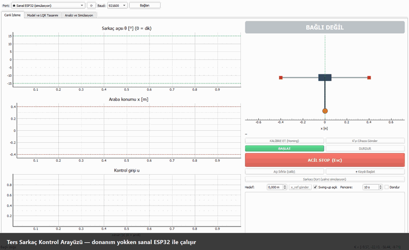

# Ters Sarkaç — Bilgisayar Mühendisliği Kısmı



🎬 Tam tanıtım videosu: [docs/media/demo.webm](docs/media/demo.webm) · 📖 Ekran görüntülü anlatım: [docs/kullanim_kilavuzu.md](docs/kullanim_kilavuzu.md)

Mekatronik + Bilgisayar disiplinlerarası ters sarkaç projesinin yazılım tarafı:

* **`pendulum_lab/`**: Matlab'in yerine geçen Python kütüphanesi. Modelleme, doğrusallaştırma, LQR, enerji bazlı swing-up, mod geçişi, simülasyon, filtreler ve seri haberleşme.
* **`gui/` + `main.py`**: Canlı izleme ve kontrol arayüzü (PyQt5 + PyQtGraph).
* **Sanal ESP32**: donanım gelmeden arayüzün uçtan uca çalıştırılabilmesi için.
* **`firmware/esp32_pendulum/`**: mekatronik ekibe referans ESP32 iskeleti (aynı kontrol mantığı).
* **`docs/`**: protokol, mimari, parametre tablosu, Matlab karşılıkları.

Ne yapıldı, mekatronik ekipte neler bekleniyor, artılar/eksiler ve yapılacaklar için bkz. **[docs/proje_durumu.md](docs/proje_durumu.md)**.

Toplantı kararlarıyla uyumludur: kontrolcü LQR (θ = 0 dikte doğrusallaştırma). |θ| > 15° iken enerji bazlı swing-up çalışır, histerezisli yazılımsal geçiş yapılır. Mikrodenetleyici ESP32, açı sensörü manyetik enkoder (AS5600), veri formatı JSON.

## Kurulum
```bash
python -m pip install -r requirements.txt
```
Python 3.10+ gerekir (3.12 ile test edildi).

## Çalıştırma
```bash
python main.py
```
1. Port olarak **★ Sanal ESP32 (simülasyon)** seçili gelir → **Bağlan**.
2. **KALİBRE ET (Homing)** → araba sola gider, limit switch'e dokunur, ortaya döner.
3. **BAŞLAT** → sarkaç swing-up ile kalkar, ±15° içinde LQR devreye girer.
4. **Sarkacı Dürt** ile dayanıklılığı deneyin. **Esc** her yerde acil stop'tur.

Gerçek kart geldiğinde aynı adımlar, port listesinden ESP32'nin COM portu seçilerek yapılır.

| Sekme | İçerik |
|---|---|
| Canlı İzleme | θ, x, u kayan grafikleri (60 FPS), araba-sarkaç animasyonu, komutlar, CSV kayıt |
| Model ve LQR Tasarımı | Parametreler, Q/R ağırlıkları → K, kutup haritası, kontrol edilebilirlik, gains.h dışa aktarma, küre/küp geometri hesaplayıcı |
| Analiz ve Simülasyon | Lineer olmayan simülasyon (sensör kusurları, gecikme, dürtme, model uyumsuzluğu) + animasyon, basamak yanıtı, kök eğrisi |

## Testler
```bash
python -m pytest -q
```
Testler şunları doğrular: analitik doğrusallaştırma ile sayısal jacobian'ın eşleşmesi, LQR/DLQR sonuçlarının `python-control` ile aynı çıkması, 500 Hz ve 12-bit sensörle LQR dengesi, aşağıdan swing-up + yakalama, %20 model hatasına dayanıklılık, protokol, halka tampon, kayıp satır sayımı ve sanal cihazla gerçek zamanlı 500 Hz kayıpsız okuma.

## Klasörler
```
pendulum_lab/   model/ control/ analysis/ sim/ comm/ filters.py recorder.py export.py
gui/            main_window, live_tab, design_tab, analysis_tab, connection_panel
config/         params.json  (YER TUTUCU değerler — mekatronik ekibi dolduracak)
firmware/       esp32_pendulum/ (referans, henüz kartta denenmedi)
docs/           protokol.md · mimari.md · parametre_tablosu.md · matlab_karsiliklari.md
tests/          pytest
tools/          demo_kayit.py (tanıtım videosu, GIF ve ekran görüntülerini üretir → docs/media/)
kayitlar/       arayüzden alınan CSV kayıtları (otomatik oluşur)
```

## Bekleyen işler (diğer ekipten)
* Gerçek fiziksel parametreler → `config/params.json` (`docs/parametre_tablosu.md`).
* Motor seçimi (DC + enkoder mi, NEMA17 mi). Step motor seçilirse `input_mode = "acceleration"`.
* Homing'i kimin başlatacağı (öneri `docs/protokol.md` §6'da).
* Montaj sonrası işaret kontrolü (`docs/protokol.md` §2).
