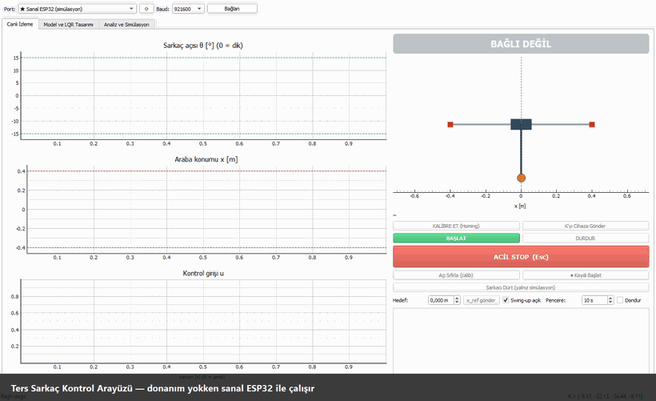

# Ters Sarkaç — Bilgisayar Mühendisliği Kısmı

[](https://github.com/ahmetselimko/Disiplinler-Aras-Proje/actions/workflows/test.yml)

> [!IMPORTANT]
> **Bu çalışma, projeyi daha iyi anlamak amacıyla hazırlanmıştır.**
> Projenin prototipi olarak sayılabilmesi için **hocamızın onayı gerekmektedir.**



🎬 Tam tanıtım videosu: [docs/media/demo.webm](docs/media/demo.webm) · 📖 Ekran görüntülü anlatım: [docs/kullanim_kilavuzu.md](docs/kullanim_kilavuzu.md)

Mekatronik + Bilgisayar disiplinlerarası ters sarkaç projesinin yazılım tarafı:

* **`pendulum_lab/`**: Matlab'in yerine geçen Python kütüphanesi. Modelleme, doğrusallaştırma, LQR, enerji bazlı swing-up, mod geçişi, simülasyon, filtreler ve seri haberleşme.
* **`gui/` + `main.py`**: Canlı izleme ve kontrol arayüzü (PyQt5 + PyQtGraph).
* **Sanal ESP32**: donanım gelmeden arayüzün uçtan uca çalıştırılabilmesi için.
* **`firmware/esp32_pendulum/`**: ESP32 kodu (aynı kontrol mantığı). Henüz derlenmedi ve kartta denenmedi.
* **`docs/`**: protokol, mimari, parametre tablosu, Matlab karşılıkları, kullanım kılavuzu.

Ne yapıldı, mekatronik ekipte neler bekleniyor, artılar/eksiler ve yapılacaklar için bkz. **[docs/proje_durumu.md](docs/proje_durumu.md)**. Güncel görevler: **[Görevler](https://github.com/ahmetselimko/Disiplinler-Aras-Proje/issues)** · **[Pano](https://github.com/users/ahmetselimko/projects/4)**.

Toplantı kararlarıyla uyumludur: kontrolcü LQR (θ = 0 dikte doğrusallaştırma). |θ| > 15° iken enerji bazlı swing-up çalışır, histerezisli yazılımsal geçiş yapılır. Mikrodenetleyici ESP32, açı sensörü manyetik enkoder (AS5600), veri formatı JSON.

## Kurulum
```bash
python -m pip install -r requirements.txt
```
Python 3.10+ gerekir (3.12 ile test edildi).

## Çalıştırma
```bash
python main.py
```
1. Port olarak **★ Sanal ESP32 (simülasyon)** seçili gelir → **Bağlan**.
2. **KALİBRE ET (Homing)** → araba sola gider, limit switch'e dokunur, ortaya döner.
3. **BAŞLAT** → sarkaç swing-up ile kalkar, ±15° içinde LQR devreye girer.
4. **Sarkacı Dürt** ile dayanıklılığı deneyin. **Esc** her yerde acil stop'tur.
5. **Duraklat** fiziği dondurur, **Sıfırla** denemeyi seçilen θ₀ açısından yeniden hazırlar. **DURDUR**'dan sonra göstergede **DURDURULDU** yazar. **Sarkacı Dürt**, **Duraklat** ve **Sıfırla** yalnız simülasyonda çalışır.

| Sekme | İçerik |
|---|---|
| Canlı İzleme | θ, x, u kayan grafikleri (60 FPS), araba-sarkaç animasyonu, komutlar, duraklat/sıfırla (simülasyon), CSV kayıt |
| Model ve LQR Tasarımı | Parametreler, Q/R ağırlıkları → K, kutup haritası, kontrol edilebilirlik, gains.h dışa aktarma, küre/küp geometri hesaplayıcı |
| Analiz ve Simülasyon | Lineer olmayan simülasyon (sensör kusurları, gecikme, dürtme, model uyumsuzluğu) + animasyon, basamak yanıtı, kök eğrisi |

## Gerçek sistemde kullanım
Arayüz gerçek ESP32'ye de bağlanacak şekilde yazıldı: port listesinden kartın COM portu seçilir, denge döngüsü kartta çalışır, arayüz izler ve komut gönderir. **Ancak bu yol henüz denenmedi.** Şimdiye kadarki bütün sonuçlar simülasyondan geliyor. Gerçek sistemde çalışması için:

1. Firmware derlenmeli ve karta yüklenmeli.
2. Pinler gerçek kablolamaya uyarlanmalı. Kod AS5600 ve BTS7960 sürücü varsayıyor; step motor için motor sürme kısmı ayrıca yazılmalı.
3. `config/params.json` gerçek ölçülerle doldurulmalı, K yeniden hesaplanıp karta gönderilmeli.
4. Motor beslemesini kesen donanımsal acil stop ve limit switch'ler takılmalı.
5. [İlk açılış kontrol listesi](firmware/esp32_pendulum/README.md#i̇lk-açılış-kontrol-listesi) sırayla uygulanmalı: işaret kontrolü → homing → yalnız LQR → swing-up.

Simülasyondaki kazançlar gerçek sistemde büyük olasılıkla yeniden ayarlanacaktır.

## Testler
```bash
python -m pytest -q
```
Testler her push ve PR'da GitHub Actions ile de otomatik çalışır. Şunları doğrular: analitik doğrusallaştırma ile sayısal jacobian'ın eşleşmesi, LQR/DLQR sonuçlarının `python-control` ile aynı çıkması, 500 Hz ve 12-bit sensörle LQR dengesi, aşağıdan swing-up + yakalama, %20 model hatasına dayanıklılık, Coulomb sürtünmesi ve telafisi, protokol, halka tampon, kayıp satır sayımı, sanal cihazla gerçek zamanlı 500 Hz kayıpsız okuma, duraklat/sıfırla ve Canlı İzleme butonları.

## Klasörler
```
pendulum_lab/   model/ control/ analysis/ sim/ comm/ filters.py recorder.py export.py
gui/            main_window, live_tab, design_tab, analysis_tab, connection_panel
config/         params.json  (YER TUTUCU değerler — mekatronik ekibi dolduracak)
firmware/       esp32_pendulum/ (henüz derlenmedi, kartta denenmedi)
docs/           protokol.md · mimari.md · parametre_tablosu.md · matlab_karsiliklari.md · kullanim_kilavuzu.md · proje_durumu.md
tests/          pytest
.github/        workflows/test.yml (GitHub Actions)
tools/          demo_kayit.py (tanıtım videosu, GIF ve ekran görüntülerini üretir → docs/media/)
kayitlar/       arayüzden alınan CSV kayıtları (otomatik oluşur)
```

## Bekleyen işler (diğer ekipten)
* Gerçek fiziksel parametreler → `config/params.json` (`docs/parametre_tablosu.md`).
* Motor seçimi (DC + enkoder mi, NEMA17 mi). Step motor seçilirse `input_mode = "acceleration"`.
* Homing'i kimin başlatacağı (öneri `docs/protokol.md` §6'da).
* Montaj sonrası işaret kontrolü (`docs/protokol.md` §2).
