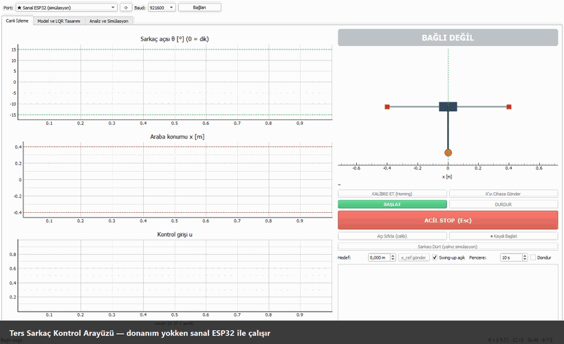

# Ters Sarkaç — Bilgisayar Mühendisliği Kısmı

[](https://github.com/ahmetselimko/Disiplinler-Aras-Proje/actions/workflows/test.yml)

> [!IMPORTANT]
> **Bu çalışma, projeyi daha iyi anlamak amacıyla hazırlanmıştır.**
> Projenin prototipi olarak sayılabilmesi için **hocamızın onayı gerekmektedir.**



🎬 Tam tanıtım videosu: [docs/media/demo.webm](docs/media/demo.webm) · 📖 Ekran görüntülü anlatım: [docs/kullanim_kilavuzu.md](docs/kullanim_kilavuzu.md)

Mekatronik + Bilgisayar disiplinlerarası ters sarkaç projesinin yazılım tarafı:

* **`pendulum_lab/`**: Matlab'in yerine geçen Python kütüphanesi. Modelleme, doğrusallaştırma, LQR, enerji bazlı swing-up, mod geçişi, simülasyon, filtreler (türev filtresi + Kalman), seri haberleşme, kayıt ve kayıt oynatma, Matlab modeliyle uyumluluk.
* **`gui/` + `main.py`**: Canlı izleme ve kontrol arayüzü (PyQt5 + PyQtGraph).
* **Sanal ESP32**: donanım gelmeden arayüzün uçtan uca çalıştırılabilmesi için.
* **`firmware/esp32_pendulum/`**: ESP32 kodu (aynı kontrol mantığı). GitHub Actions'ta iki kart (ESP32-S3, klasik ESP32) × iki core sürümüyle hatasız derleniyor; **kartta henüz denenmedi**.
* **`matlab/`**: mekatronik ekibinin Matlab/Simulink dosyaları (`cart_pendulum_lqr.m`, `cart_pendulum_application.m`, `cart_pendulum_lqr_sim.slx`). Model Python kütüphanesiyle aynıdır; θ işareti de aynı (sola yatınca pozitif, #50); bkz. [matlab/README.md](matlab/README.md).
* **`docs/`**: protokol, mimari, parametre tablosu, Matlab karşılıkları, kullanım kılavuzu, görev katkı belgeleri.

Ne yapıldı, mekatronik ekipte neler bekleniyor, artılar/eksiler ve yapılacaklar için bkz. **[docs/proje_durumu.md](docs/proje_durumu.md)**. Güncel görevler: **[Görevler](https://github.com/ahmetselimko/Disiplinler-Aras-Proje/issues)** · **[Pano](https://github.com/users/ahmetselimko/projects/4)**.

Toplantı kararlarıyla uyumludur: kontrolcü LQR (θ = 0 dikte doğrusallaştırma). |θ| > 15° iken enerji bazlı swing-up çalışır, histerezisli yazılımsal geçiş yapılır. Mikrodenetleyici ESP32, açı sensörü manyetik enkoder (AS5600), veri formatı JSON.

## Kurulum
```bash
python -m pip install -r requirements.txt
```
Python 3.10+ gerekir (3.12 ile test edildi).

## Çalıştırma
```bash
python main.py
```
1. Port olarak **★ Sanal ESP32 (simülasyon)** seçili gelir → **Bağlan**.
2. **KALİBRE ET (Homing)** → araba sola gider, limit switch'e dokunur, ortaya döner.
3. **BAŞLAT** → sarkaç swing-up ile kalkar, ±15° içinde LQR devreye girer.
4. **Dürt** ile dayanıklılığı deneyin: kuvvet (N), süre (ms) ve yer (**sarkaca** ya da Matlab'daki "Apply push" gibi **arabaya**) seçilir. **Esc** her yerde acil stop'tur.
5. **Duraklat** fiziği dondurur, **Sıfırla** denemeyi seçilen θ₀ açısından yeniden hazırlar. **DURDUR**'dan sonra göstergede **DURDURULDU** yazar. **Dürt**, **Duraklat** ve **Sıfırla** yalnız simülasyonda çalışır.
6. **● Kaydı Başlat** ile alınan CSV, **Kayıt Oynatma** sekmesinde aynı başlangıç koşullu simülasyonla üst üste çizilebilir.

| Sekme | İçerik |
|---|---|
| Canlı İzleme | θ, x, u, enerji ve mod kayan grafikleri (60 FPS), araba-sarkaç animasyonu, deneme özeti, komutlar, kuvvet/süre/yer seçilebilen dürtme ve duraklat/sıfırla (simülasyon), CSV kayıt |
| Model ve LQR Tasarımı | Parametreler (g dahil), Q/R ağırlıkları → K, kutup haritası, kontrol edilebilirlik, swing-up ayarları (hedef enerji oranı dahil), LQR'a geçiş şartları (açı, açısal hız, araba konumu ve hızı), gains.h dışa aktarma, küre/küp geometri hesaplayıcı |
| Analiz ve Simülasyon | Lineer olmayan simülasyon (başlangıç konum/hızları, sensör kusurları, Kalman aç/kapa, gecikme, kuvvet/süre/yer seçilebilen dürtme, model uyumsuzluğu) + animasyon; **Matlab uyumlu** deneme (`cart_pendulum_application.m` ile aynı); basamak yanıtı, kök eğrisi |
| Kayıt Oynatma | CSV kaydını açar; θ, x, u, enerji ve modu aynı başlangıç koşullu simülasyonla üst üste çizer, RMSE verir, 0.25x–2x animasyon |

## Gerçek sistemde kullanım
Arayüz gerçek ESP32'ye de bağlanacak şekilde yazıldı: port listesinden kartın COM portu seçilir, denge döngüsü kartta çalışır, arayüz izler ve komut gönderir. **Ancak bu yol henüz denenmedi.** Şimdiye kadarki bütün sonuçlar simülasyondan geliyor. Gerçek sistemde çalışması için:

1. Firmware karta yüklenmeli (derleme CI'da doğrulanıyor).
2. Kablolama `firmware/esp32_pendulum/board_pins.h`'deki pinlere göre yapılmalı. Donanım (BOM v3, 13.11.2026): ESP32-S3-DevKitC-1 N16R8, BTS7960 sürücü, AS5600 açı sensörü, HTD3M 20 dişli kasnak (`config/params.json`'da r = 9.55 mm). **Motor JGB37-520 19:1** (mekatronik raporu, son seçim); motor değerleri raporun Tablo 16'sından türetildi, enkoder 44 CPR (836 sayım / çıkış turu, 0.072 mm/sayım); datasheet ve motorla doğrulanacak.
3. `config/params.json` gerçek ölçülerle doldurulmalı, K yeniden hesaplanıp karta gönderilmeli.
4. Limit switch'ler takılacak (firmware varsayılanı `LIMIT_SWITCHES 1`; switch tipi ve pinleri teyit edilmeli). Donanımsal acil stop **yok**: motor beslemesi elle kolayca kesilebilmeli (fiş/anahtar). Esc ve switch'ler yalnız kart çalışırken motoru durdurur.
5. [İlk açılış kontrol listesi](firmware/esp32_pendulum/README.md#i̇lk-açılış-kontrol-listesi) sırayla uygulanmalı: işaret kontrolü → homing → yalnız LQR → swing-up.

Simülasyondaki kazançlar gerçek sistemde büyük olasılıkla yeniden ayarlanacaktır.

## Testler

Enerji/mod grafikleri, deneme özeti, CSV ayar kaydı ve parametre hassasiyet
taramasının tanımları ve çalıştırılması: **[3, 6 ve 13 numaralı görevler](docs/katki_3_6_13.md)**.
Üretilen sonuçlar: [hassasiyet raporu](docs/hassasiyet_raporu.md).

**Swing-up karar çalışması** (#50 Aşama 3; uç kütlesi × geçiş kuralı × hedef enerji oranı × ray × sürtünme
telafisi, her durum 3 tohum ve m, l ±%5): `python tools/swingup_karar.py` (~900 koşu, 2 çekirdekte ~8 dk;
`--hizli` tek durumla dener). Sonuç: [docs/swingup_karar_calismasi.md](docs/swingup_karar_calismasi.md).

```bash
python -m pytest -q
```
Testler her push ve PR'da GitHub Actions ile de otomatik çalışır; firmware de aynı iş akışında iki kart (ESP32-S3, klasik ESP32) × iki core sürümüyle derlenir. Şunları doğrular: analitik doğrusallaştırma ile sayısal jacobian'ın eşleşmesi, LQR/DLQR sonuçlarının `python-control` ile aynı çıkması, 500 Hz ve 12-bit sensörle LQR dengesi, aşağıdan swing-up + yakalama, karma bir model hatasında (M +%20, m −%15, l +%10) yakalama, Coulomb sürtünmesi ve telafisi, Kalman filtresinin titreşimi azaltması, Python–firmware parametre/protokol eşliği, Matlab modeliyle (doğrusal ve doğrusal olmayan) eşleşme, kayıt oynatma, protokol, halka tampon, kayıp satır sayımı, sanal cihazla gerçek zamanlı 500 Hz kayıpsız okuma, duraklat/sıfırla ve arayüz butonları.

## Klasörler
```
pendulum_lab/   model/ control/ analysis/ sim/ comm/ filters.py recorder.py export.py
gui/            main_window, live_tab, design_tab, analysis_tab, playback_tab, connection_panel, state, widgets
config/         params.json (+20 g, varsayılan), params_ucsuz.json, params_50g.json — mekatronik raporu (23.11) TASARIM değerleri, ölçüm değil
firmware/       esp32_pendulum/ (CI'da derleniyor, kartta denenmedi)
matlab/         mekatronik ekibinin Matlab/Simulink dosyaları
docs/           protokol.md · mimari.md · parametre_tablosu.md · matlab_karsiliklari.md · kullanim_kilavuzu.md · proje_durumu.md · katki_*.md
tests/          pytest
.github/        workflows/test.yml (GitHub Actions)
tools/          demo_kayit.py (tanıtım videosu/GIF) · hassasiyet_analizi.py · motor_karsilastirma.py · rapor_sekilleri.py · mekatronik_on_degerlendirme.py · swingup_karar.py
kayitlar/       arayüzden alınan CSV kayıtları (otomatik oluşur)
```

## Bekleyen işler (diğer ekipten)
* Gerçek fiziksel parametreler → `config/params.json` (`docs/parametre_tablosu.md`).
* Seçilen JGB37-520 motorun datasheet'i ya da ölçümü: R, Kt, Ke, enkoder CPR (şimdilik rapordaki Tablo 16 ve 836 sayım/tur'dan; `ENC_CPR_MOTOR` = 44).
* Uç kütlesi kararı (yok / +20 g / +50 g; şimdilik +20 g) ve raydaki gerçek kullanılabilir yol.
* Montaj sonrası işaret kontrolü (`docs/protokol.md` §2).
