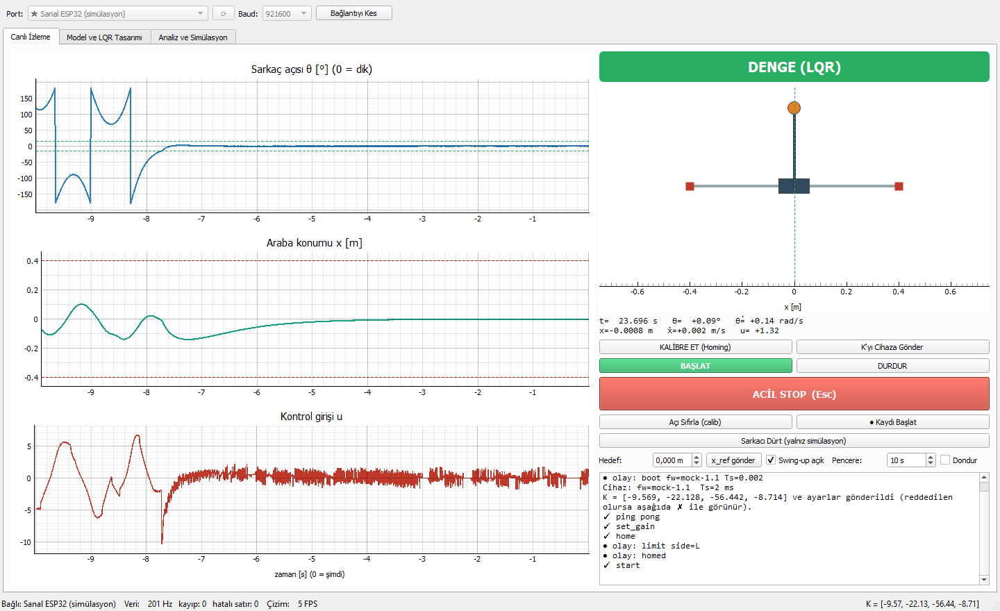
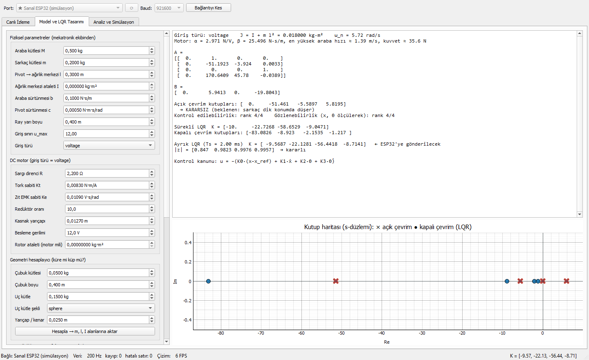
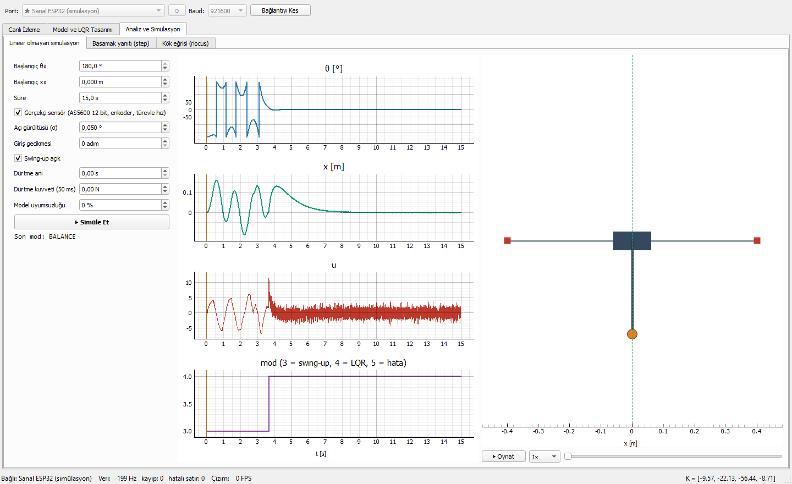
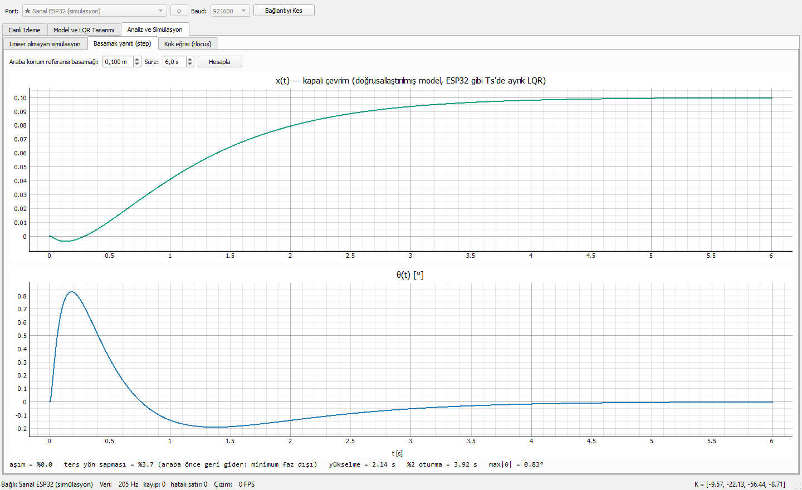
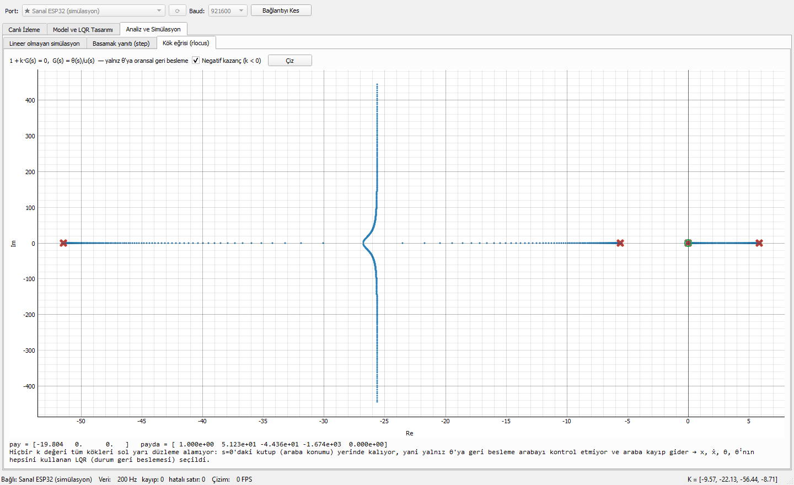

# Kullanım Kılavuzu — Ters Sarkaç Kontrol Arayüzü

🎬 **Tanıtım videosu (44 s):** [docs/media/demo.webm](media/demo.webm). GitHub'da açılmazsa "Download raw file" ile indirip tarayıcıda veya VLC'de açın.


> Video ve görüntüler `python tools/demo_kayit.py` ile otomatik üretilir; arayüz değişince bu komutla yenilenir. Kayıt sırasında ekran yakalandığı için durum çubuğundaki "Çizim FPS" düşük görünür. Normal kullanımda ~60 FPS'tir.

---

## 0. Kurulum ve başlatma
```bash
python -m pip install -r requirements.txt
python main.py
```

## 1. Bağlanma
Üstteki **Port** listesinde varsayılan olarak **★ Sanal ESP32 (simülasyon)** seçilidir. Donanım yokken her şey bu sanal cihazla denenir. Gerçek kart takılıysa listede ESP32'nin COM portu da görünür (yenilemek için ⟳). Baud: **921600**. **Bağlan**'a basın.

Bağlanınca arayüz cihaza `ping` gönderir. Cihazın kontrol periyodu (Ts) tasarımdakiyle aynıysa K ve tüm ayarlar otomatik yüklenir ve sağ alttaki günlükte görünür. Ts farklıysa K **gönderilmez** ve uyarı çıkar.

## 2. Canlı İzleme sekmesi



| Bölge | Ne gösterir / ne yapar |
|---|---|
| Sol grafikler | Sarkaç açısı θ (0 = dik; yeşil kesikli çizgiler LQR devreye girme sınırı ±15°), araba konumu x (kırmızı kesikli çizgiler ray uçları), kontrol girişi u (volt). Son 10 s kayarak çizilir |
| Yeşil/turuncu/kırmızı kutu | Mod: BEKLEMEDE · KALİBRASYON · SWING-UP · DENGE (LQR) · HATA/STOP |
| Animasyon | Araba ve sarkacın anlık konumu; yeşil kesikli çizgi hedef konum |
| **KALİBRE ET (Homing)** | Araba yavaşça sol limit switch'e gider, orayı −ray yarı boyu kabul eder, ortaya döner. **Bu yapılmadan BAŞLAT kabul edilmez** |
| **BAŞLAT** | Swing-up açıksa sarkacı aşağıdan kaldırır; \|θ\| < 15° olunca LQR devreye girer |
| **DURDUR** | Motoru durdurur (IDLE). Hata modundan çıkmak için de kullanılır |
| **ACİL STOP** / **Esc** | Motor hemen kapanır (FAULT). Esc tuşu açık bir pencere varken de çalışır |
| **K'yı Cihaza Gönder** | Tasarım sekmesindeki güncel K ve ayarları gönderir |
| **Açı Sıfırla (calib)** | Sarkaç aşağıda ve hareketsizken açı sıfırını yeniden bulur. Açılışta sarkaç sallanıyorduysa kullanılır |
| **Kaydı Başlat** | Telemetriyi `kayitlar/oturum_….csv` dosyasına yazar (Excel/Matlab ile açılır) |
| **Sarkacı Dürt** | Yalnız simülasyonda: sarkaca darbe verir, LQR'ın toparlamasını görmek için |
| Hedef + x_ref gönder | Dengedeyken arabanın gideceği konum (ray sınırına göre kısıtlanır) |
| Swing-up açık | Kapatılırsa cihaz sarkacın elle dik konuma getirilmesini bekler (WAIT), sonra LQR tutar. İlk donanım denemesinde önerilir |
| Durum çubuğu | Veri hızı (Hz), kayıp satır, hatalı satır, çizim FPS, güncel K |

**Tipik akış:** Bağlan → KALİBRE ET → (BEKLEMEDE'ye dönünce) BAŞLAT → DENGE (LQR) → gerekirse DURDUR.

## 3. Model ve LQR Tasarımı sekmesi



1. **Fiziksel parametreler** ve **DC motor** değerlerini girin. Mekatronik ekibinin ölçüleri için bkz. [parametre_tablosu.md](parametre_tablosu.md).
2. İsterseniz **Geometri hesaplayıcı** ile çubuk + küre/küp uç kütleden m, l, I hesaplayıp alanlara aktarın.
3. **LQR ağırlıklarını** (Q: x, ẋ, θ, θ̇; R: giriş cezası) ve ESP32 kontrol periyodunu (tam sayı ms) seçin.
4. **K Hesapla**. Sağda şunlar görünür:
   - A, B matrisleri;
   - açık çevrim kutupları (biri sağ yarı düzlemde → dik konum kararsız, beklenen);
   - kontrol edilebilirlik;
   - sürekli ve **ayrık K** (ESP32'ye giden bu);
   - kapalı çevrim kutupları ve kutup haritası.
   
   Motorla ulaşılabilecek en yüksek araba hızı düşükse uyarı çıkar.
5. **Cihaza Gönder** (bağlıyken) veya **gains.h Dışa Aktar** (firmware'e gömmek için). **Parametre Kaydet/Yükle** `config/params.json` biçimindedir.

Q[θ]'yı büyütmek açıyı daha sıkı tutar; Q[x]'i büyütmek arabayı hedefe daha hızlı getirir; R'yi büyütmek motoru daha yumuşak kullanır.

## 4. Analiz ve Simülasyon sekmesi

### Lineer olmayan simülasyon


Başlangıç açısı (180° = aşağıda), süre, gerçekçi sensör (AS5600 12-bit, türevle hız), gürültü, gecikme, dürtme anı/kuvveti ve **model uyumsuzluğu** (gerçek sistem tasarımdan %X farklı) seçilip **▶ Simüle Et**'e basılır. Sonuç θ, x, u ve mod grafikleriyle gelir; sağda **▶ Oynat** ile animasyon izlenir (hız 0.25x–2x). Solda özet: LQR'ın ilk devreye girdiği an, en büyük |x| (ray sınırına göre), en büyük |u|.

Gerçek parametreler gelince **ilk iş** buradan θ₀ = 180° ile denemektir: son mod BALANCE olmalı ve max |x| ray sınırının altında kalmalı.

### Basamak yanıtı


Araba hedef konumuna basamak verildiğinde x(t) ve θ(t) çizilir. Araba önce **ters yöne** kayar: bu ters sarkacın doğasıdır (minimum faz dışı). Aşım, yükselme ve oturma süresi altta yazılır.

### Kök eğrisi


Yalnız θ'ya oransal geri besleme verilseydi köklerin nasıl hareket edeceğini gösterir. Bir kök hep s = 0'da kalır (araba kontrol edilmez). Bu yüzden dört durumu da kullanan LQR seçildi.

## 5. Gerçek kartla ilk deneme (özet)
1. Firmware'i yükleyin (`firmware/esp32_pendulum/README.md`), sarkaç aşağıda ve hareketsizken kartı açın.
2. [protokol.md](protokol.md) §2'deki işaret kontrolünü yapın (θ ve x yönleri, motor yönü).
3. Arayüzde portu seçip Bağlan → KALİBRE ET. Eliniz acil stop butonunda olsun.
4. **Swing-up açık** kutusunu kaldırın, BAŞLAT'a basın, sarkacı elle dik tutup bırakın: yalnız LQR'ı deneyin.
5. Sonra swing-up'ı açıp aşağıdan deneyin. Kayıt alıp simülasyonla karşılaştırın.

## 6. Sık karşılaşılanlar
| Belirti | Sebep / çözüm |
|---|---|
| BAŞLAT'a basınca "✗ start: önce home" | Önce KALİBRE ET |
| "✗ start: hata modunda: önce stop" | Hata (FAULT) sonrası önce DURDUR |
| "✗ start: açı kalibrasyonu başarısız" | Sarkacı aşağıda durdurup **Açı Sıfırla (calib)** |
| "UYARI: cihaz Ts = … ms, tasarım Ts = … ms" | Tasarım sekmesinde Ts'yi cihazınkiyle aynı yapıp K Hesapla → Cihaza Gönder |
| "olay: fault reason=homing_wrong_side" | Homing'de araba sağa gitti: motor veya enkoder yönü ters (protokol.md §2) |
| Veri hızı 0 / "Bağlantı koptu" | Kablo, port, baud (921600) kontrolü; ESP32'nin seri monitörü açıksa kapatın |
