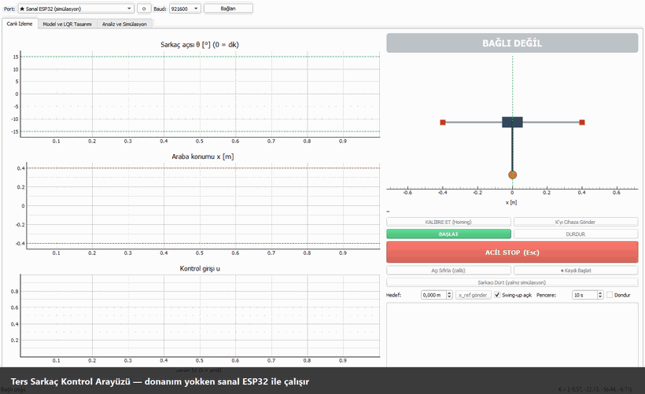
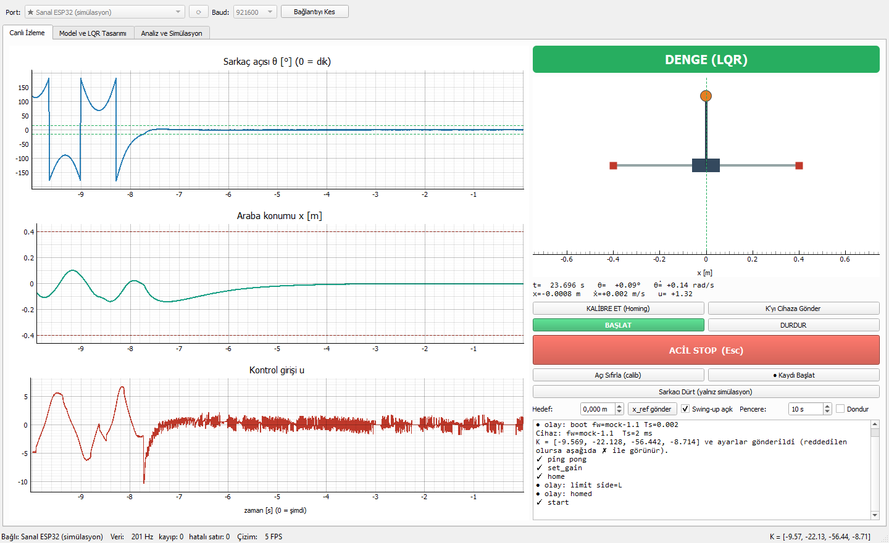
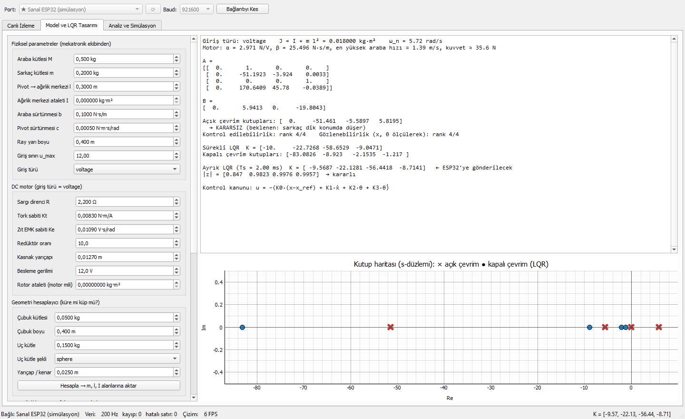
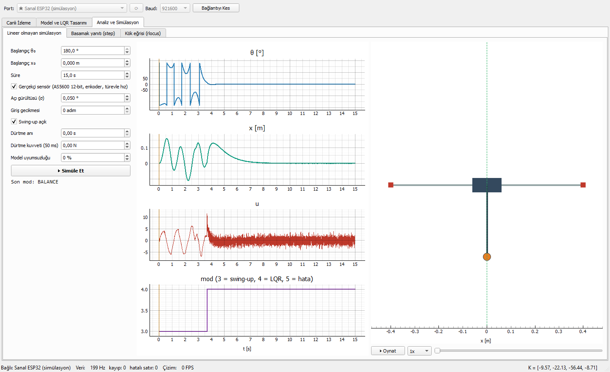
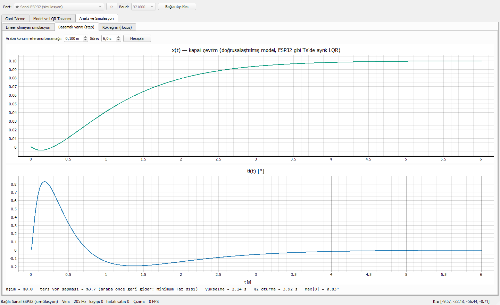
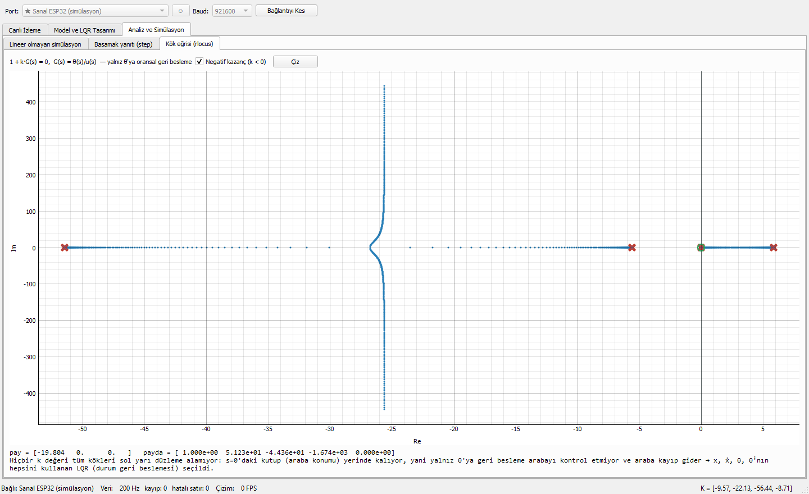

# Kullanım Kılavuzu — Ters Sarkaç Kontrol Arayüzü

🎬 **Tanıtım videosu (~45 s):** [docs/media/demo.webm](media/demo.webm). GitHub'da açılmazsa "Download raw file" ile indirip tarayıcıda veya VLC'de açın.



> Video ve görüntüler `python tools/demo_kayit.py` ile otomatik üretilir; arayüz değişince bu komutla yenilenir. Kayıt sırasında ekran yakalandığı için durum çubuğundaki "Çizim FPS" düşük görünür. Normal kullanımda ~60 FPS'tir.

---

## 0. Kurulum ve başlatma
```bash
python -m pip install -r requirements.txt
python main.py
```

## 1. Bağlanma
Üstteki **Port** listesinde varsayılan olarak **★ Sanal ESP32 (simülasyon)** seçilidir. Donanım yokken her şey bu sanal cihazla denenir. Gerçek kart takılıysa listede ESP32'nin COM portu da görünür (yenilemek için ⟳). Baud: **921600**. **Bağlan**'a basın.

Bağlanınca arayüz cihaza `ping` gönderir. Swing-up açık/kapalı anahtarı her durumda (güvenlik) gönderilir. K ve diğer ayarlar ise yalnız cihaz θ kuralını `"theta":"sol"` olarak bildirdiyse (#50; eski firmware bildirmez), cihazın kontrol periyodu (Ts) tasarımdakiyle aynıysa, parametreler yer tutucu değilse ve giriş türü `voltage` ise otomatik yüklenir ve sağ alttaki günlükte görünür. Ts farklıysa K **gönderilmez** ve uyarı çıkar; yer tutucu parametrelerle gerçek kartta K yalnız **K'yı Cihaza Gönder** ile onaylanarak gider.

## 2. Canlı İzleme sekmesi



| Bölge | Ne gösterir / ne yapar |
|---|---|
| Sol grafikler | Sarkaç açısı θ (0 = dik, pozitif = sola yatık; yeşil kesikli çizgiler LQR devreye girme sınırı ±15°), araba konumu x (kırmızı kesikli çizgiler ray uçları), kontrol girişi u (volt), sarkacın enerjisi E (0 = dik konum enerjisi) ve mod. Son 10 s kayarak çizilir |
| Sonuç Özeti | Son denemenin özeti: dengeye geçiş anı, oturma süresi, en büyük \|x\| ve \|u\|, doyumda geçen süre, bitiş modu |
| Yeşil/turuncu/kırmızı kutu | Mod: BEKLEMEDE · KALİBRASYON · SWING-UP · DENGE (LQR) · DURDURULDU · HATA/STOP. DURDURULDU, DURDUR'dan sonraki BEKLEMEDE'dir (yalnız arayüzde). Simülasyon duraklatılmışsa başında ⏸ görünür |
| Animasyon | Araba ve sarkacın anlık konumu; yeşil kesikli çizgi hedef konum |
| **KALİBRE ET (Homing)** | Araba yavaşça sol limit switch'e gider, orayı −ray yarı boyu kabul eder, ortaya döner. İki kademeli düzende (`END_SENSORS 2`) referans içteki optik sensördür ve sıfır −ray yarı boyu + 3 cm'de alınır; araba optik bölgesinde başlarsa önce sağa çekilir. Araba dıştaki mikro switch'e basarsa homing `homing_overrun` ile durur. (Sensörler takılmadan denenecekse firmware `END_SENSORS 0` ile derlenir; o zaman araba elle ortaya konup durağanken basılır, o nokta x = 0 olur.) **Bu yapılmadan BAŞLAT kabul edilmez** |
| **BAŞLAT** | Swing-up açıksa sarkacı aşağıdan kaldırır; \|θ\| < 15° olunca LQR devreye girer |
| **DURDUR** | Motoru durdurur (IDLE). Hata modundan çıkmak için de kullanılır |
| **ACİL STOP** / **Esc** | Motor hemen kapanır (FAULT). Esc tuşu açık bir pencere varken de çalışır |
| **K'yı Cihaza Gönder** | Tasarım sekmesindeki güncel K ve ayarları gönderir |
| **Açı Sıfırla (calib)** | Sarkaç aşağıda ve hareketsizken açı sıfırını yeniden bulur. Açılışta sarkaç sallanıyorduysa kullanılır |
| **Sürtünme Ölç** | KALİBRE ET'ten sonra, sarkaç aşağıda dururken. Araba önce sağa sonra sola ~8 cm'er gider ve motor + kayış sürtünmesini gerilim olarak ölçer (gösterge: SÜRTÜNME ÖLÇÜMÜ, ~5 s). Sonuç penceresinde onaylanırsa T_f parametrelere yazılır ve telafi karta gönderilir; kalıcı olması için Tasarım sekmesinde **Parametre Kaydet**. Eğim satırı motor sabitlerinin kontrolüdür: ölçülen ile model çok farklıysa motor değerleri gözden geçirilmeli |
| **● Kaydı Başlat** | Telemetriyi `kayitlar/` klasörüne yazar: sanal ESP32'de `sim_….csv`, gerçek kartta `gercek_….csv`. Kaynak dosyanın başında da yazar (Excel/Matlab ile açılır) |
| **Dürt** + kuvvet, süre, yer | Yalnız simülasyonda: girilen yatay kuvveti (N) verilen süre (ms) boyunca uygular, LQR'ın toparlamasını görmek için. Yer **sarkaca** (ağırlık merkezine) veya **arabaya** (Matlab'daki "Apply push" ile aynı). Varsayılan 1.2 N × 50 ms sarkaca: θ̇'yi ~1 rad/s değiştirir. Pozitif kuvvet sağa iter: sarkaca sağa itme dik sarkacı sağa (θ < 0), arabaya sağa itme sarkacı sola (θ > 0) yatırır |
| **Duraklat / Devam Et** | Yalnız simülasyonda: fizik ve kontrol donar, grafikler son değerlerle akmaya devam eder. Grafiği yalnızca ekranda donduran **Dondur** kutusundan farklıdır |
| **Sıfırla** + θ₀ | Yalnız simülasyonda: BEKLEMEDE'ye döner, duraklatmayı kaldırır, sarkacı θ₀ açısında (180° = aşağıda, 0° = dik, pozitif = sola yatık) durağan koyar. Kalibre edildiyse araba x = 0 noktasına gelir, kalibrasyonun tekrarı gerekmez |
| Hedef + x_ref gönder | Dengedeyken arabanın gideceği konum (ray sınırına göre kısıtlanır) |
| Swing-up açık | Kapatılırsa cihaz sarkacın elle dik konuma getirilmesini bekler (WAIT), sonra LQR tutar. Swing-up sürerken kapatılırsa pompalama hemen durur. İlk donanım denemesinde önerilir |
| Durum çubuğu | Veri hızı (Hz), kayıp satır, hatalı satır, çizim FPS, güncel K |

**Tipik akış:** Bağlan → KALİBRE ET → (BEKLEMEDE'ye dönünce) BAŞLAT → DENGE (LQR) → gerekirse DURDUR.

## 3. Model ve LQR Tasarımı sekmesi



1. **Fiziksel parametreler** ve **DC motor** değerlerini girin. Mekatronik ekibinin ölçüleri için bkz. [parametre_tablosu.md](parametre_tablosu.md).
2. İsterseniz **Geometri hesaplayıcı** ile çubuk + küre/küp uç kütleden m, l, I hesaplayıp alanlara aktarın.
3. **LQR ağırlıklarını** (Q: x, ẋ, θ, θ̇; R: giriş cezası) ve ESP32 kontrol periyodunu (tam sayı ms) seçin.
4. **K Hesapla**. Sağda şunlar görünür:
   - A, B matrisleri;
   - açık çevrim kutupları (biri sağ yarı düzlemde → dik konum kararsız, beklenen);
   - kontrol edilebilirlik;
   - sürekli ve **ayrık K** (ESP32'ye giden bu);
   - kapalı çevrim kutupları ve kutup haritası.
   
   Motorla ulaşılabilecek en yüksek araba hızı düşükse uyarı çıkar.
5. **Cihaza Gönder** (bağlıyken) veya **gains.h Dışa Aktar** (firmware'e gömmek için). **Parametre Kaydet/Yükle** `config/params.json` biçimindedir.

Q[θ]'yı büyütmek açıyı daha sıkı tutar; Q[x]'i büyütmek arabayı hedefe daha hızlı getirir; R'yi büyütmek motoru daha yumuşak kullanır.

**Swing-up ve geçiş** grubu:
- `k_E`, `a_max`, `k_x`, `k_v`: swing-up enerji kazancı, ivme sınırı ve arabayı ortada tutan kazançlar.
- **Hedef enerji oranı** (`E_ratio`): swing-up'ın hedeflediği enerji / dik konum enerjisi. 1 = tam dik konum; 1'den büyükse sarkaç dik konuma daha hızlı gelir.
- **LQR devreye girme** şartları: açı \|θ\| < sınır **ve** açısal hız, araba konumu \|x\| ve araba hızı sınırların altında. Araba konum/hız sınırlarının varsayılanları (0.4 m, 2 m/s) geçişi kısıtlamaz; gerçek denemelerde daraltılabilir.
- **LQR bırakma**: \|θ\| bu değeri aşınca swing-up'a dönülür (histerezis).

Bu ayarlar **Cihaza Gönder** ile karta gider ve **gains.h Dışa Aktar** ile firmware'e gömülür.

## 4. Analiz ve Simülasyon sekmesi

### Lineer olmayan simülasyon


Başlangıç açısı (180° = aşağıda), başlangıç konumu x₀ ve hızları ẋ₀, θ̇₀, süre, gerçekçi sensör (AS5600 12-bit, 44 CPR × 19 enkoder), **Kalman filtresi** (dik bölgede hız Kalman ile kestirilir; firmware'deki gibi varsayılan açık, kapatılırsa yalnız 25 Hz türev filtresi), gürültü, gecikme, dürtme anı/kuvveti/süresi/yeri (sarkaca veya arabaya) ve **model uyumsuzluğu** (gerçek sistem tasarımdan %X farklı) seçilip **▶ Simüle Et**'e basılır. Sonuç θ, x, u ve mod grafikleriyle gelir; sağda **▶ Oynat** ile animasyon izlenir (hız 0.25x–2x). Solda özet: LQR'ın ilk devreye girdiği an, en büyük |x| (ray sınırına göre), en büyük |u|.

Gerçek parametreler gelince **ilk iş** buradan θ₀ = 180° ile denemektir: son mod BALANCE olmalı ve max |x| ray sınırının altında kalmalı.

**Matlab uyumlu** kutusu, mekatronik ekibinin `cart_pendulum_application.m` denemesini Python'da tekrarlar: sürekli zamanlı LQR, kuvvet girişi (motor yok), ideal sensör, 2.5 ms RK4; araba ±0.2 m'ye ulaşınca veya \|θ\| ≥ 90° olunca deneme durur. Swing-up yoktur (θ₀ 90°'den küçük olmalı); dürtme Matlab'daki gibi arabaya uygulanır.
- **Matlab'ın kendi ayarlarıyla** (varsayılan): `cart_pendulum_lqr.m`'deki parametreler, Q, R ve ±10 N kuvvet sınırı kullanılır; sonuç ve K Matlab'ınkiyle karşılaştırılabilir.
- Kapatılırsa projenin parametreleri ve Tasarım sekmesindeki Q, R kullanılır, kuvvet sınırı yoktur; o zaman gösterilen K Matlab'ın K'sı değildir.

K tek satırda gösterilir: #50'den beri projede de Matlab'daki gibi θ sola pozitiftir, K'lar doğrudan karşılaştırılabilir. Ayrıntı: [matlab/README.md](../matlab/README.md).

### Basamak yanıtı


Araba hedef konumuna basamak verildiğinde x(t) ve θ(t) çizilir. Araba önce **ters yöne** kayar: bu ters sarkacın doğasıdır (minimum faz dışı). Aşım, yükselme ve oturma süresi altta yazılır.

### Kök eğrisi


Yalnız θ'ya oransal geri besleme verilseydi köklerin nasıl hareket edeceğini gösterir. Bir kök hep s = 0'da kalır (araba kontrol edilmez). Bu yüzden dört durumu da kullanan LQR seçildi.

## 5. Kayıt Oynatma sekmesi
Gerçek (veya sanal) denemenin kaydını modelle karşılaştırmak için:
1. Soldaki listeden `kayitlar/` içindeki bir CSV'yi seçin (sekmeye geçince liste yenilenir, ↻ ile elle de) ya da **📂 CSV Seç…** ile başka bir dosya açın.
2. **▶ Karşılaştır / Yenile**: kaydın BAŞLAT anındaki durumundan (hızlar dahil) aynı ayarlarla simülasyon yapılır.
   - **Kayıttaki model ve K ayarlarını kullan**: kayıt başlığındaki parametreler ve o ana kadar cihazın onayladığı ayarlar kullanılır; deneme sırasında değişen ayarlar uyarı olarak yazılır. Kapatılırsa arayüzdeki güncel ayarlar kullanılır.
   - **Yalnız aktif denemeyi hizala**: yalnız BAŞLAT → bitiş aralığı gösterilir; kapatılırsa kaydın tamamı gösterilir, simülasyon BAŞLAT anına hizalanır.
   - **Gerçekçi sensör** ve **Kalman** kutuları Analiz sekmesindekiyle aynı anlamdadır.
3. θ, x, u, enerji ve mod grafiklerinde kayıt düz, simülasyon kesikli çizilir; özet kutusunda RMSE(θ, x, u) ve en büyük hatalar yazar. **▶ Oynat** kaydı zaman damgalarına göre 0.25x–2x hızla canlandırır.

RMSE büyükse önce parametreleri (özellikle motor değerleri ve sürtünme) gözden geçirin.

## 6. Gerçek kartla ilk deneme (özet)
1. Firmware'i yükleyin (`firmware/esp32_pendulum/README.md`), sarkaç aşağıda ve hareketsizken kartı açın.
2. [protokol.md](protokol.md) §2'deki işaret kontrolünü yapın (θ ve x yönleri, motor yönü).
3. Arayüzde portu seçip Bağlan → KALİBRE ET. Donanımsal acil stop olmadığı için bir eliniz Esc'de, motor beslemesinin fişi/anahtarı da erişebileceğiniz yerde olsun (Esc yalnız kart ve bağlantı çalışırken etkilidir). Bağlantı koparsa (USB çekildi, program kapandı) kart 1 s içinde motoru kendisi keser (FAULT `link`). Ama arayüz açık kalıp tamamen donarsa kart çalışmaya devam eder ve Esc/DURDUR işlemez: o zaman **USB kablosunu çekin** (kart 1 s içinde durur) ya da motor beslemesini kesin.
4. **Swing-up açık** kutusunu kaldırın, BAŞLAT'a basın, sarkacı elle dik tutup bırakın: yalnız LQR'ı deneyin.
5. Sonra swing-up'ı açıp aşağıdan deneyin. Kayıt alıp **Kayıt Oynatma** sekmesinde simülasyonla karşılaştırın.

## 7. Sık karşılaşılanlar
| Belirti | Sebep / çözüm |
|---|---|
| BAŞLAT'a basınca "✗ start: önce home" | Önce KALİBRE ET |
| "✗ start: hata modunda: önce stop" | Hata (FAULT) sonrası önce DURDUR |
| "✗ start: araba ray ucuna çok yakın" | **KALİBRE ET** ile arabayı ortaya alın |
| "✗ start: araba hâlâ hareket ediyor" | Arabanın durmasını bekleyip tekrar **BAŞLAT** |
| "✗ sürtünme ölçümü: yeterli hıza ulaşılamadı" | Gerilim (6 V), yol (8 cm) veya süre sınırına takıldı: sürtünme çok yüksek ya da araba sıkışıyor. Mekanizmayı elle itip kontrol edin |
| "✗ start: açı kalibrasyonu başarısız" | Sarkacı aşağıda durdurup **Açı Sıfırla (calib)** |
| Gerçek karta bağlanınca "Yer tutucu parametreler" uyarısı, K gönderilmiyor | `config/params.json` hâlâ yer tutucu. Tasarım sekmesinde ölçülmüş değerleri girip **Ölçülmüş gerçek değerler** kutusunu işaretleyin, **Parametre Kaydet**. Kart o zamana kadar derlendiği `gains.h` ile çalışır |
| "UYARI: cihaz θ kuralını bildirmedi ya da farklı bildirdi" / "K gönderilmedi: cihazın θ kuralı …" | Kartta #50 öncesi (θ sağa +) firmware var: K gönderilmez, θ grafikleri ve animasyon ters; kayıtlara `cihaz_theta_pozitif: sag` yazılır, oynatmada θ çevrilir. Firmware'i güncelleyin; `gains.h`'yi arayüzden yeniden dışa aktarın (eski `gains.h` yeni firmware'le derlenmez) |
| "K gönderilmedi: cihaz bilgisi (ping yanıtı) henüz gelmedi" | Bağlandıktan hemen sonra basıldı (kayıt da bu durumda başlatılmaz) ya da ping yanıtı kayboldu. Arayüz bilgiyi yeniden ister; birkaç saniye sonra tekrar deneyin, olmazsa yeniden bağlanın |
| "UYARI: cihaz Ts = … ms, tasarım Ts = … ms" | Tasarım sekmesinde Ts'yi cihazınkiyle aynı yapıp K Hesapla → Cihaza Gönder |
| "olay: fault reason=homing_wrong_side" | Homing'de sağ uç sensörü tetiklendi: motor veya enkoder yönü ters (protokol.md §2) ya da sağ sensörün kablosu kopuk/sürekli basılı |
| "olay: fault reason=homing_switch" | Sol uç sensörü araba uzaklaştığı hâlde basılı kalıyor: kablosu kopuk ya da sensör takılı. Kabloyu ve sensörü kontrol edin |
| Veri hızı 0 / "Bağlantı koptu" | Kablo, port, baud (921600) kontrolü; ESP32'nin seri monitörü açıksa kapatın |
