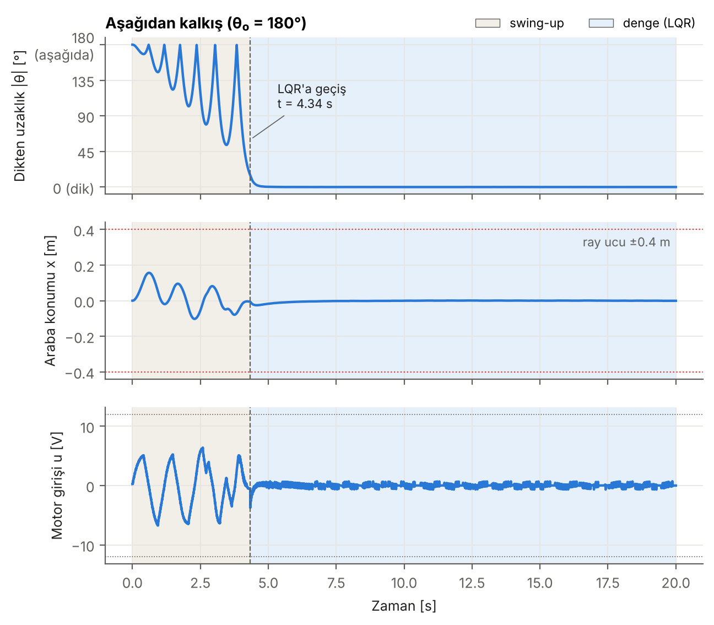
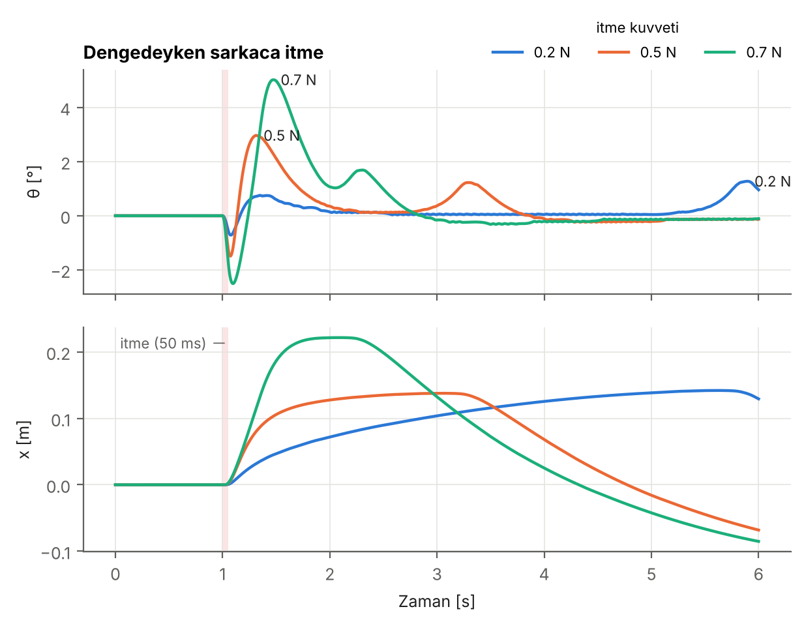
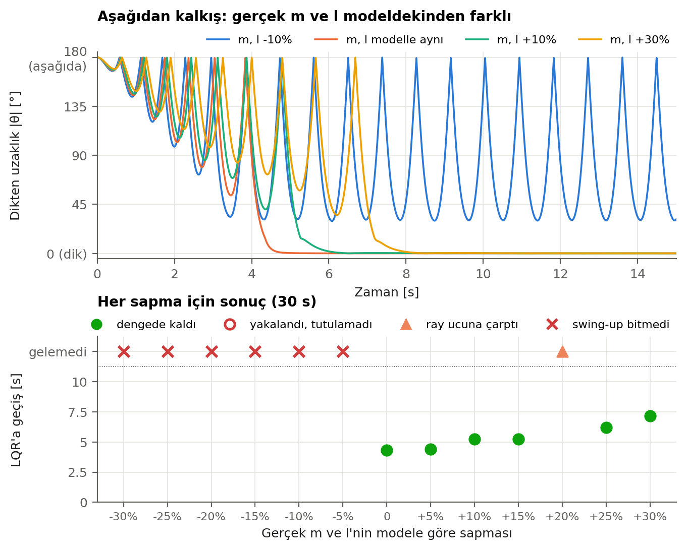

# Rapor şekilleri

`tools/rapor_sekilleri.py` ile 23.11.2026 tarihinde üretildi. **Elle düzenlemeyin;** parametreler değişince script'i yeniden çalıştırın.

* Parametreler: `config/params.json` (M = 0.5 kg, m = 0.2 kg, l = 0.3 m, ray ±0.4 m, giriş: motor gerilimi, |u| ≤ 12 V)
* Kontrolcü: arayüzün varsayılanları; Q = diag(10.0, 1.0, 100.0, 1.0), R = 0.1, Ts = 2 ms, yakalama 15°, bırakma 30°, enerji bazlı swing-up (hedef enerji oranı 1)
* K = [-9.52, -27.29, -61.49, -9.74]
* Sensör: 12-bit açı ve 48 CPR enkoder kuantalaması; dik bölgede Kalman (firmware gibi)

> ⚠ **Parametreler yer tutucu değerlerdir.** Mekatronik ekibi gerçek ölçüleri `config/params.json`'a girince şekiller yeniden üretilmelidir; sayılar değişecektir.

## 1. Aşağıdan kalkış — `asagidan_kalkis.png`

*Şekil 1. Sarkaç aşağıda (θ₀ = 180°) dururken enerji bazlı swing-up ile sallanır, |θ| < 15° olunca LQR'a geçilir. Gri bölge swing-up, mavi bölge denge modudur.*

| LQR'a geçiş | Yerleşme (±2°) | Max \|x\| | Max \|u\| | Sonuç |
|---|---|---|---|---|
| 4.34 s | 4.61 s | 0.157 m | 6.74 V | dengede kaldı |

## 2. Dürtmeye tepki — `durtme.png`

*Şekil 2. Sarkaç dengedeyken t = 1 s'de ağırlık merkezine 50 ms süren yatay itme uygulanır. Kuvvetler, LQR'ın kurtarabildiği en büyük itmenin %30, %60, %90'ıdır.*

| İtme | Max \|θ\| | Max \|x\| | İtmeden sonra yerleşme (±2°) | Sonuç |
|---|---|---|---|---|
| 1 N | 3.3° | 0.090 m | 0.52 s | dengede kaldı |
| 2 N | 6.6° | 0.178 m | 0.73 s | dengede kaldı |
| 3 N | 9.9° | 0.297 m | 0.88 s | dengede kaldı |

LQR'ın swing-up'a düşmeden kurtarabildiği en büyük itme (aynı süreyle): **≈ 3.3 N**. Daha büyük itmelerde LQR sarkacı tutamıyor; sarkaç düşüyor ya da araba ray ucuna çarpıyor.

## 3. Kutup haritası — `kutup_haritasi.png`

*Şekil 3. Dik konum etrafında doğrusallaştırılmış modelin açık çevrim kutupları ve LQR ile kapalı çevrim kutupları. Sağdaki panel sıfır civarını büyütür; açık çevrimdeki pozitif kutup sarkacın dik konumda kararsız olduğunu gösterir. Ayrık zamanlı (Ts = 2 ms) karşılıklar tablodadır; hepsi birim çemberin içindedir.*

| | Kutuplar |
|---|---|
| Açık çevrim (s) | -99.42, -5.66, 0.00, 5.77 |
| Kapalı çevrim (s karşılığı) | -136.78, -8.50, -2.81, -0.86 |
| Kapalı çevrim (z) | 0.7607, 0.9831, 0.9944, 0.9983 (en büyük \|z\| = 0.9983) |

## 4. Model uyumsuzluğu — `model_uyumsuzlugu.png`

*Şekil 4. Kontrolcü nominal modelle tasarlanır; simülasyondaki "gerçek" sarkacın kütlesi ve ağırlık merkezi uzaklığı birlikte −%30 … +%30 değiştirilir (arayüzdeki "model uyumsuzluğu" ayarı). Aşağıdan kalkış, 30 s.*

| m ve l sapması | Sonuç | LQR'a geçiş | Max \|x\| | Dike en yakın (t > 3 s) |
|---|---|---|---|---|
| -30% | swing-up bitmedi | — | 0.173 m | 53.4° |
| -25% | swing-up bitmedi | — | 0.148 m | 48.4° |
| -20% | swing-up bitmedi | — | 0.171 m | 41.5° |
| -15% | swing-up bitmedi | — | 0.203 m | 33.9° |
| -10% | swing-up bitmedi | — | 0.200 m | 29.7° |
| -5% | swing-up bitmedi | — | 0.155 m | 17.1° |
| +0% | dengede kaldı | 4.34 s | 0.157 m | 0.0° |
| +5% | dengede kaldı | 4.41 s | 0.157 m | 0.0° |
| +10% | dengede kaldı | 5.26 s | 0.226 m | 0.0° |
| +15% | dengede kaldı | 5.26 s | 0.156 m | 0.0° |
| +20% | ray ucuna çarptı | 6.23 s | 0.400 m | 10.6° |
| +25% | dengede kaldı | 6.21 s | 0.157 m | 0.0° |
| +30% | dengede kaldı | 7.18 s | 0.209 m | 0.0° |

**Not:** Gerçek sarkaç modeldekinden hafif/kısa olduğunda (-30% … -5%) swing-up tamamlanmıyor: sarkaç her salınımda dik konuma ancak 17–53°'ye kadar yaklaşıyor, 15°'lik yakalama bölgesine giremiyor. Olası sebep: swing-up hedef enerjiyi nominal modelle hesaplıyor; gerçek sarkaç farklıysa bu hedef de kayıyor. Bu, [hassasiyet raporundaki](../../hassasiyet_raporu.md) `l` parametresinin "KRİTİK" sonucuyla tutarlıdır.

Araba ray ucuna çarpan noktalar: +20%.
