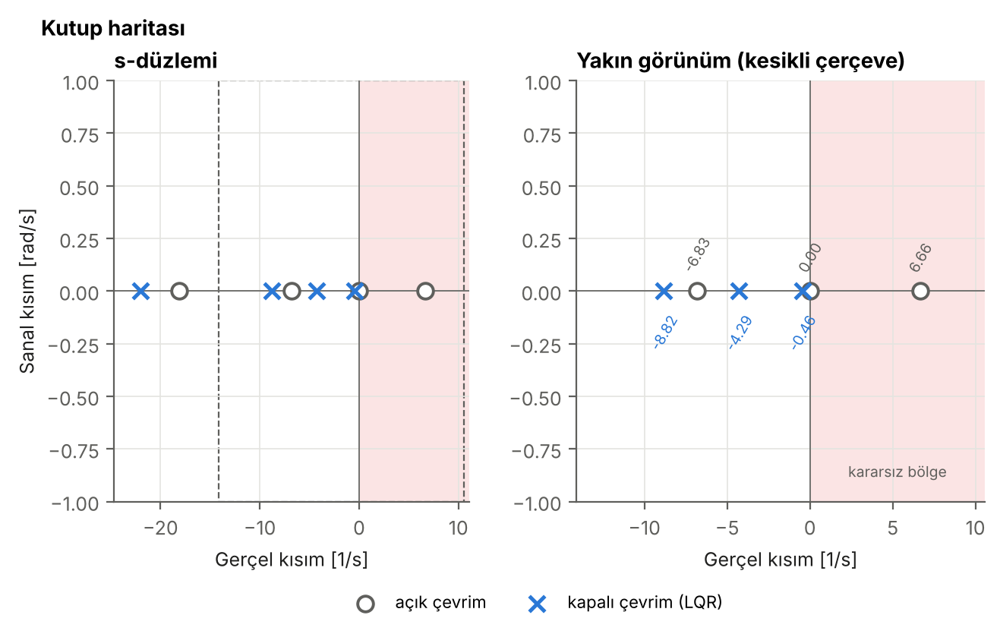

# Rapor şekilleri

`tools/rapor_sekilleri.py` ile 25.11.2026 tarihinde üretildi. **Elle düzenlemeyin;** parametreler değişince script'i yeniden çalıştırın.

* Parametreler: `config/params.json` (M = 1.28 kg, m = 0.105 kg, l = 0.0992 m, ray ±0.4 m, giriş: motor gerilimi, |u| ≤ 12 V)
* Kontrolcü: arayüzün varsayılanları; Q = diag(10.0, 1.0, 100.0, 1.0), R = 0.1, Ts = 2 ms, yakalama 15°, bırakma 30°, enerji bazlı swing-up (hedef enerji oranı 1.05)
* K = [-9.83, -46.64, 101.47, 14.36]
* Sensör: 12-bit açı ve enkoder kuantalaması (motor milinde 44 CPR × 19 redüktör = 836 sayım/tur, 0.072 mm/sayım); dik bölgede Kalman (firmware gibi)

> ⚠ **Parametreler yer tutucu değerlerdir** (`config/params.json`, ölçüm değil). Gerçek ölçüler girilince şekiller yeniden üretilmelidir; sayılar değişecektir.

## 1. Aşağıdan kalkış — `asagidan_kalkis.png`

*Şekil 1. Sarkaç aşağıda (θ₀ = 180°) dururken enerji bazlı swing-up ile sallanır, |θ| < 15° olunca LQR'a geçilir. Gri bölge swing-up, mavi bölge denge modudur.*

| LQR'a geçiş | Yerleşme (±2°) | Max \|x\| | Max \|u\| | Sonuç |
|---|---|---|---|---|
| 4.32 s | 4.56 s | 0.142 m | 12.00 V | dengede kaldı |

## 2. Dürtmeye tepki — `durtme.png`

*Şekil 2. Sarkaç dengedeyken t = 1 s'de ağırlık merkezine 50 ms süren yatay itme uygulanır. Kuvvetler, LQR'ın kurtarabildiği en büyük itmenin %30, %60, %90'ıdır.*

| İtme | Max \|θ\| | Max \|x\| | İtmeden sonra yerleşme (±2°) | Sonuç |
|---|---|---|---|---|
| 0.2 N | 1.3° | 0.142 m | — | dengede kaldı |
| 0.5 N | 3.0° | 0.138 m | 0.52 s | dengede kaldı |
| 0.7 N | 5.0° | 0.222 m | 0.82 s | dengede kaldı |

LQR'ın swing-up'a düşmeden kurtarabildiği en büyük itme (aynı süreyle): **≈ 0.8 N**. Daha büyük itmelerde LQR sarkacı tutamıyor; sarkaç düşüyor ya da araba ray ucuna çarpıyor.

## 3. Kutup haritası — `kutup_haritasi.png`

*Şekil 3. Dik konum etrafında doğrusallaştırılmış modelin açık çevrim kutupları ve LQR ile kapalı çevrim kutupları. Sağdaki panel sıfır civarını büyütür; açık çevrimdeki pozitif kutup sarkacın dik konumda kararsız olduğunu gösterir. Ayrık zamanlı (Ts = 2 ms) karşılıklar tablodadır; hepsi birim çemberin içindedir.*

| | Kutuplar |
|---|---|
| Açık çevrim (s) | -18.14, -6.83, 0.00, 6.66 |
| Kapalı çevrim (s karşılığı) | -22.02, -8.82, -4.29, -0.46 |
| Kapalı çevrim (z) | 0.9569, 0.9825, 0.9915, 0.9991 (en büyük \|z\| = 0.9991) |

## 4. Model uyumsuzluğu — `model_uyumsuzlugu.png`

*Şekil 4. Kontrolcü nominal modelle tasarlanır; simülasyondaki "gerçek" sarkacın kütlesi ve ağırlık merkezi uzaklığı birlikte −%30 … +%30 değiştirilir (arayüzdeki "model uyumsuzluğu" ayarı). Aşağıdan kalkış, 30 s.*

| m ve l sapması | Sonuç | LQR'a geçiş | Max \|x\| | Dike en yakın (t > 3 s) |
|---|---|---|---|---|
| -30% | swing-up bitmedi | — | 0.163 m | 90.8° |
| -25% | swing-up bitmedi | — | 0.156 m | 85.3° |
| -20% | dengede kaldı | 7.65 s | 0.193 m | 0.0° |
| -15% | dengede kaldı | 5.63 s | 0.148 m | 0.0° |
| -10% | düştü, swing-up yeniden kaldırdı | 4.93 s | 0.314 m | 0.0° |
| -5% | dengede kaldı | 4.23 s | 0.142 m | 0.0° |
| +0% | dengede kaldı | 4.32 s | 0.142 m | 0.0° |
| +5% | dengede kaldı | 3.56 s | 0.143 m | 0.0° |
| +10% | dengede kaldı | 3.55 s | 0.142 m | 0.0° |
| +15% | dengede kaldı | 3.57 s | 0.156 m | 0.0° |
| +20% | dengede kaldı (ray ucuna yakın) | 3.60 s | 0.322 m | 0.0° |
| +25% | LQR yakaladı ama tutamadı | 3.64 s | 0.278 m | 11.6° |
| +30% | swing-up bitmedi | — | 0.132 m | 15.5° |

**Not:** Gerçek sarkaç modeldekinden hafif/kısa olduğunda (-30% … -25%) swing-up tamamlanmıyor: sarkaç her salınımda dik konuma ancak 85–91°'ye kadar yaklaşıyor, 15°'lik yakalama bölgesine giremiyor. Olası sebep: swing-up hedef enerjiyi nominal modelle hesaplıyor; gerçek sarkaç farklıysa bu hedef de kayıyor. Bu, [hassasiyet raporundaki](../../hassasiyet_raporu.md) `l` parametresinin "KRİTİK" sonucuyla tutarlıdır.

**Not:** Gerçek sarkaç modeldekinden ağır/uzun olduğunda (+30%) swing-up tamamlanmıyor: sarkaç her salınımda dik konuma ancak 16°'ye kadar yaklaşıyor, 15°'lik yakalama bölgesine giremiyor. Olası sebep: swing-up hedef enerjiyi nominal modelle hesaplıyor; gerçek sarkaç farklıysa bu hedef de kayıyor.

**Not:** -10% sapmada LQR sarkacı yakaladıktan sonra bıraktı; swing-up yeniden kaldırdı ve deneme dengede bitti (tablodaki geçiş zamanı ilk yakalamadır).

**Not:** +25% sapmada sarkaç yakalama bölgesine girip LQR'a geçti, ama LQR onu tutamadı ve swing-up süre sonuna kadar yeniden tamamlanmadı. LQR nominal modelle tasarlandığı için sapma büyüyünce denge payı azalıyor.
