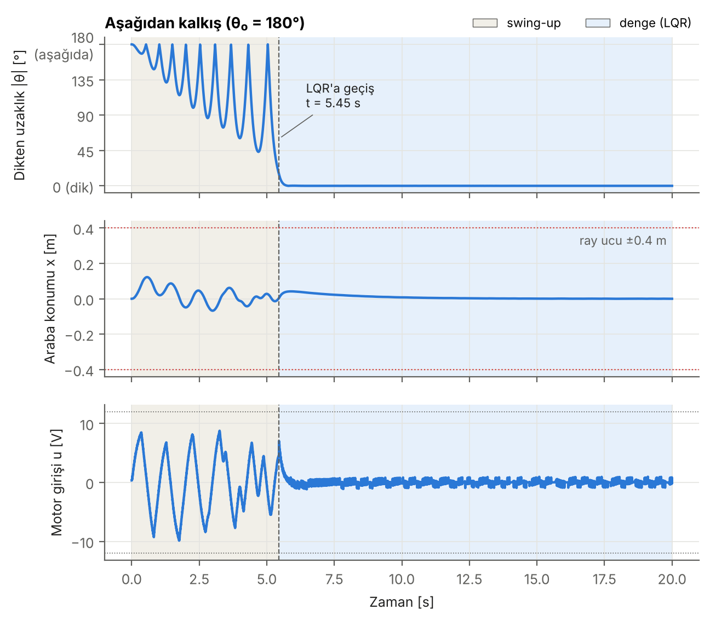
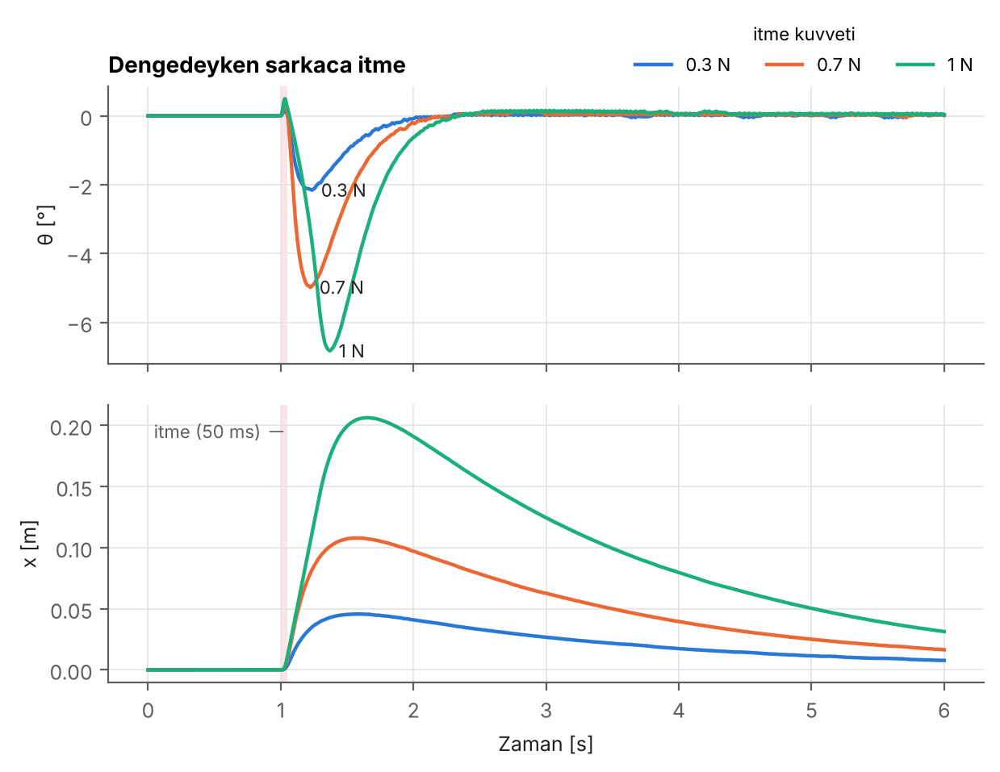
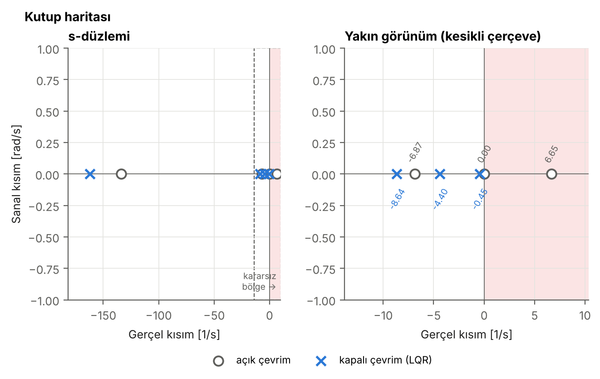
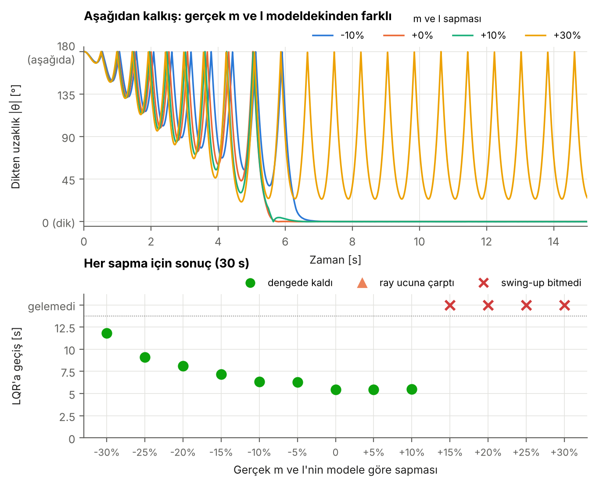

# Rapor şekilleri

`tools/rapor_sekilleri.py` ile 23.11.2026 tarihinde üretildi. **Elle düzenlemeyin;** parametreler değişince script'i yeniden çalıştırın.

* Parametreler: `config/params_mekatronik_tasarim.json` (M = 1.28 kg, m = 0.105 kg, l = 0.0992 m, ray ±0.4 m, giriş: motor gerilimi, |u| ≤ 12 V)
* Kontrolcü: arayüzün varsayılanları; Q = diag(10.0, 1.0, 100.0, 1.0), R = 0.1, Ts = 2 ms, yakalama 15°, bırakma 30°, enerji bazlı swing-up (hedef enerji oranı 1.05)
* K = [-9.59, -46.64, -80.89, -11.31]
* Sensör: 12-bit açı ve 48 CPR enkoder kuantalaması; dik bölgede Kalman (firmware gibi)

> ⚠ **Parametreler yer tutucu değerlerdir.** Mekatronik ekibi gerçek ölçüleri `config/params.json`'a girince şekiller yeniden üretilmelidir; sayılar değişecektir.
> Swing-up hedef enerji oranı arayüz varsayılanından (1.0) farklı: **1.05**.

## 1. Aşağıdan kalkış — `asagidan_kalkis.png`

*Şekil 1. Sarkaç aşağıda (θ₀ = 180°) dururken enerji bazlı swing-up ile sallanır, |θ| < 15° olunca LQR'a geçilir. Gri bölge swing-up, mavi bölge denge modudur.*

| LQR'a geçiş | Yerleşme (±2°) | Max \|x\| | Max \|u\| | Sonuç |
|---|---|---|---|---|
| 5.45 s | 5.64 s | 0.122 m | 9.88 V | dengede kaldı |

## 2. Dürtmeye tepki — `durtme.png`

*Şekil 2. Sarkaç dengedeyken t = 1 s'de ağırlık merkezine 50 ms süren yatay itme uygulanır. Kuvvetler, LQR'ın kurtarabildiği en büyük itmenin %30, %60, %90'ıdır.*

| İtme | Max \|θ\| | Max \|x\| | İtmeden sonra yerleşme (±2°) | Sonuç |
|---|---|---|---|---|
| 0.3 N | 2.2° | 0.046 m | 0.28 s | dengede kaldı |
| 0.7 N | 5.0° | 0.108 m | 0.55 s | dengede kaldı |
| 1 N | 6.8° | 0.206 m | 0.77 s | dengede kaldı |

LQR'ın swing-up'a düşmeden kurtarabildiği en büyük itme (aynı süreyle): **≈ 1.1 N**. Daha büyük itmelerde LQR sarkacı tutamıyor; sarkaç düşüyor ya da araba ray ucuna çarpıyor.

## 3. Kutup haritası — `kutup_haritasi.png`

*Şekil 3. Dik konum etrafında doğrusallaştırılmış modelin açık çevrim kutupları ve LQR ile kapalı çevrim kutupları. Sağdaki panel sıfır civarını büyütür; açık çevrimdeki pozitif kutup sarkacın dik konumda kararsız olduğunu gösterir. Ayrık zamanlı (Ts = 2 ms) karşılıklar tablodadır; hepsi birim çemberin içindedir.*

| | Kutuplar |
|---|---|
| Açık çevrim (s) | -133.91, -6.87, 0.00, 6.65 |
| Kapalı çevrim (s karşılığı) | -162.11, -8.64, -4.40, -0.45 |
| Kapalı çevrim (z) | 0.7231, 0.9829, 0.9912, 0.9991 (en büyük \|z\| = 0.9991) |

## 4. Model uyumsuzluğu — `model_uyumsuzlugu.png`

*Şekil 4. Kontrolcü nominal modelle tasarlanır; simülasyondaki "gerçek" sarkacın kütlesi ve ağırlık merkezi uzaklığı birlikte −%30 … +%30 değiştirilir (arayüzdeki "model uyumsuzluğu" ayarı). Aşağıdan kalkış, 30 s.*

| m ve l sapması | Sonuç | LQR'a geçiş | Max \|x\| | Dike en yakın (t > 3 s) |
|---|---|---|---|---|
| -30% | dengede kaldı | 11.83 s | 0.143 m | 0.0° |
| -25% | dengede kaldı | 9.08 s | 0.139 m | 0.0° |
| -20% | dengede kaldı | 8.12 s | 0.133 m | 0.0° |
| -15% | dengede kaldı | 7.20 s | 0.131 m | 0.0° |
| -10% | dengede kaldı | 6.31 s | 0.128 m | 0.0° |
| -5% | dengede kaldı | 6.31 s | 0.126 m | 0.0° |
| +0% | dengede kaldı | 5.45 s | 0.122 m | 0.0° |
| +5% | dengede kaldı | 5.44 s | 0.122 m | 0.0° |
| +10% | dengede kaldı | 5.49 s | 0.201 m | 0.0° |
| +15% | swing-up bitmedi | — | 0.119 m | 19.6° |
| +20% | swing-up bitmedi | — | 0.118 m | 19.5° |
| +25% | swing-up bitmedi | — | 0.118 m | 20.5° |
| +30% | swing-up bitmedi | — | 0.117 m | 21.0° |

**Not:** Gerçek sarkaç modeldekinden ağır/uzun olduğunda (+15% … +30%) swing-up tamamlanmıyor: sarkaç her salınımda dik konuma ancak 19–21°'ye kadar yaklaşıyor, 15°'lik yakalama bölgesine giremiyor. Olası sebep: swing-up hedef enerjiyi nominal modelle hesaplıyor; gerçek sarkaç farklıysa bu hedef de kayıyor.
